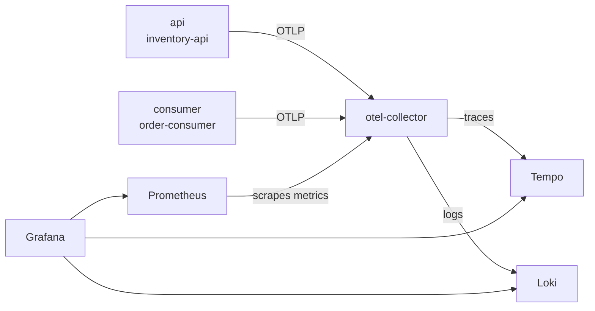

# Ecommerce Backend

[](https://github.com/BirasaDivine/Ecommerce_Backend/actions/workflows/ci.yml)

An ASP.NET Core Web API for an e-commerce inventory and order management platform.

## Stack

- ASP.NET Core 10 Web API
- EF Core 10 with SQL Server 
- ASP.NET Core Identity for users/roles
- JWT bearer authentication
- NUnit + `WebApplicationFactory` for integration tests, EF Core InMemory for service-level tests
- Scalar for interactive API docs in Development (`/scalar/v1`)
- Azure Service Bus (local emulator) for asynchronous order processing
- Docker + Docker Compose for the full local stack

## Roles

- **Admin** — manages categories, products, variants, and collections.
- **User** — any authenticated account; can purchase products.
- **Public (unauthenticated)** — can browse and search products only.

## Getting started

### Prerequisites

- .NET 10 SDK
- SQL Server or SQL Server LocalDB (the default connection string targets `(localdb)\mssqllocaldb`)

### Configuration

`appsettings.json` holds the connection string (`Database:ConnectionString`) and non-secret JWT settings (`Issuer`, `Audience`,
`ExpiryMinutes`). `appsettings.Development.json` ships a placeholder `Jwt:Key` for local development
only — it must not be reused anywhere else. For a real environment, override it with user secrets
or an environment variable instead of committing a key:

```bash
cd Ecommerce_Backend
dotnet user-secrets set "Jwt:Key" "<a long random string>"
```

Each configuration section is bound to an options class in `Configuration/` (`JwtOptions`,
`ServiceBusOptions`, `DatabaseOptions`, `HealthCheckSettingsOptions`, `SeedAdminOptions`) and
validated at startup, so the app fails fast with a clear message if, for example, `Jwt:Key` is
missing or shorter than 32 characters, or `ServiceBus:ConnectionString` is unset.

In Development only, a `SeedAdmin:Email` / `SeedAdmin:Password` pair (defaulting to
`admin@ecommerce.local` / `Admin123!`) is seeded on startup along with the `Admin` and `User` roles.
This seeding does not run outside Development.

`appsettings.json` also holds the non-secret `ServiceBus:QueueName`. `ServiceBus:ConnectionString`
follows the same rule as `Jwt:Key` . For local development it points at the Azure
Service Bus emulator , which accepts the fixed, non-secret development connection string:

```bash
cd Ecommerce_Backend
dotnet user-secrets set "ServiceBus:ConnectionString" "Endpoint=sb://localhost;SharedAccessKeyName=RootManageSharedAccessKey;SharedAccessKey=SAS_KEY_VALUE;UseDevelopmentEmulator=true;"
```

| Setting | Default | Purpose |
|---|---|---|
| `Database:ConnectionString` | LocalDB `EcommerceDb` | SQL Server connection string (`Database__ConnectionString` as an environment variable) |
| `Api:Enabled` | `true` | Serve the HTTP API (controllers, auth, seeding). The `consumer` compose service sets it to `false` |
| `Consumer:Enabled` | `true` | Run the order-processing consumer. The `api` compose service sets it to `false` |
| `HealthChecks:TimeoutSeconds` | `5` | Per-check timeout for the health endpoints (1–120) |
| `Telemetry:Exporter` | `Console` | Where telemetry goes: `Console`, `Otlp` (to the Collector) or `None`. Compose sets `Otlp` |
| `Telemetry:OtlpEndpoint` | empty | The Collector's OTLP/gRPC address, required when the exporter is `Otlp` (compose: `http://otel-collector:4317`) |
| `Telemetry:SamplingRatio` | `1.0` | Fraction of traces kept, 0 to 1. In compose set it with `OTEL_SAMPLING_RATIO` in `.env` |
| `Telemetry:MetricExportIntervalSeconds` | `10` | How often metrics are pushed (1 to 300) |
| `Telemetry:ServiceName`, `Telemetry:Environment` | role based, host environment | Override `service.name` (`inventory-api` or `order-consumer`) and `deployment.environment` |

### Run everything with Docker Compose

The compose file runs these services. Secrets come from a git-ignored `.env` file:

| Service | Role |
|---|---|
| `migrator` | One-off job: applies the EF Core migrations with a migration bundle, then exits |
| `api` | HTTP API only (`Consumer__Enabled=false`) |
| `consumer` | Same image with the HTTP API switched off (`Api__Enabled=false`); processes the `order-placed` queue |
| `db` | SQL Server 2022 with the `db-data` volume |
| `servicebus-emulator`, `sql-edge` | Local Service Bus and its backing store |
| `servicebus-emulator-ready` | One-shot probe that waits for the emulator's `/health` |
| `otel-collector`, `tempo`, `loki`, `prometheus`, `grafana` | The observability stack, see [Observability](#observability) |

```bash
cp .env.example .env   # then replace the placeholder passwords and JWT key
docker compose up --build
```

- The API listens on `http://localhost:8080` (`API_PORT` to change it); Scalar is at `/scalar/v1`.
  The consumer publishes no port; it only has the health endpoints inside the network.
- Start-up order: `db` healthy, then `migrator` runs to completion, then `api` and `consumer` start
  (once the emulator's `/health` returns 200). So the tables exist before anything serves traffic,
  and a failed migration stops the stack instead of crash-looping the API.
- The API seeds the `Admin`/`User` roles and the admin from `SEED_ADMIN_EMAIL` / `SEED_ADMIN_PASSWORD`
  in Development. The consumer does not seed and needs no JWT key.
- The image is a multi-stage build (SDK to publish, `aspnet` runtime to run) that runs as the base
  image's non-root `app` user and contains only the API project. The `migrator` image is a separate
  target of the same Dockerfile (`runtime-deps` plus the self-contained migration bundle).
- Starting a process with both `Api__Enabled=false` and `Consumer__Enabled=false` fails at startup.
- Database data lives in the `db-data` volume; `docker compose down -v` wipes it.

Check the stack with the scripts in `scripts/` (PowerShell; they read the admin login from `.env`):

```powershell
./scripts/smoke-test.ps1              # starts the stack, checks it, stops the database, tears everything down
./scripts/e2e-consumer-recovery.ps1   # with the stack running: stop only the consumer, buy, restart it
```

**Why SQL Server in Docker:** the EF Core provider and all existing migrations target SQL Server, and
the current search and uniqueness checks rely on its case-insensitive default collation. Switching to
PostgreSQL would have meant regenerating every migration and changing that behaviour, for a smaller
image. The `sql-edge` container is separate: it is required by the Service Bus emulator itself and is
not the app's database.

### Local Service Bus emulator only

Order placement publishes to Azure Service Bus; the consumer role (a background service) processes the
messages. To run just the emulator (e.g. for `dotnet run` or the integration tests), with `.env` in place:

```bash
docker compose up -d servicebus-emulator
```

This starts `sql-edge` (the emulator's backing store) and `servicebus-emulator`, pre-configured with a
session-enabled `order-placed` queue, plus `order-placed-tests` for the integration tests (see `docker/servicebus-emulator/Config.json`). The emulator speaks
the real `Azure.Messaging.ServiceBus` protocol, so the app code doesn't know the difference.

### Health checks

| Endpoint | Checks | Use |
|---|---|---|
| `GET /health/live` | Process is up (no dependency checks) | Liveness probe |
| `GET /health/ready` | SQL Server reachable, `order-placed` queue reachable | Readiness probe |

Both return `200` when healthy and `503` otherwise, with a JSON status per check (no exception
details, since the endpoints are anonymous).

## Observability

One `docker compose up` starts the shop and a complete observability stack, all local. No hosted service
is used. The API and the consumer are instrumented with OpenTelemetry and send traces, metrics and logs
to an OpenTelemetry Collector, which forwards them to Tempo (traces), Prometheus (metrics) and Loki
(logs). Grafana shows all three.



### Prerequisites

- Docker with Compose v2 (developed and tested with Docker 29.8 and Compose 5.6). The stack runs about a
  dozen containers, and SQL Server alone wants around 2 GB of memory, so give Docker Desktop enough
  memory and several GB of disk for the images.
- PowerShell for the helper scripts (Windows PowerShell 5.1 or PowerShell 7).
- A `.env` file: `cp .env.example .env` and replace the placeholder values (see Configuration above).

### Start and stop

```powershell
docker compose up -d --build --wait   # start everything (first run downloads the images)
docker compose ps                     # every service Up; migrator and servicebus-emulator-ready Exited (0)
docker compose down                   # stop, keep the data
docker compose down -v                # stop and delete all data volumes
```

### Services and URLs

| Service | URL or port | Notes |
|---|---|---|
| API | http://localhost:8080 | `API_PORT` in `.env` changes it. Health: `/health/live`, `/health/ready`. Version: `/version` |
| Swagger / Scalar docs | http://localhost:8080/scalar/v1 | Development only |
| Grafana | http://localhost:3000 | `GRAFANA_PORT` in `.env` changes it. Login: `GRAFANA_ADMIN_USER` and `GRAFANA_ADMIN_PASSWORD` from your `.env` |
| Prometheus | http://localhost:9090 | `PROMETHEUS_PORT` in `.env` changes it |
| SQL Server | localhost:1433 | `sa` with `DB_SA_PASSWORD` from `.env` |
| Service Bus emulator | localhost:5672 (AMQP), localhost:5300 (health) | Local development only |
| OpenTelemetry Collector | `otel-collector:4317` (gRPC), `:4318` (HTTP) | Inside the Docker network only |
| Tempo, Loki | `tempo:3200`, `loki:3100` | Inside the Docker network only; reach them through Grafana |

Grafana's login comes only from `.env`, which is git-ignored. Its data sources, dashboard and alert are
provisioned from files in `observability/grafana/`, so nothing has to be configured in the UI.

### Place a purchase and find it in Grafana

1. Start the stack (above) and wait until `http://localhost:8080/health/ready` returns 200.
2. Place purchases. The simplest way is the scripts, which log in with the seed admin from `.env`:

   ```powershell
   ./scripts/e2e-consumer-recovery.ps1   # a handful of purchases
   ./scripts/load-test.ps1               # 6 in stock, 20 purchases at once: 6 Confirmed, 14 Rejected
   ```

   Or by hand: register and log in at `/api/auth/register` and `/api/auth/login`, create a category and a
   product as the admin, then `POST /api/orders` with `{ "variantId": 1, "quantity": 1 }` and a Bearer token.
   It answers `202 Accepted` with the order in `Pending`; poll `GET /api/orders/{id}` until it is `Confirmed`
   (status `1`) or `Rejected` (`2`).
3. Within about a minute, open Grafana and sign in:
   - **Metrics and dashboard:** Dashboards, folder Shop, **Shop overview**. It shows request rate, 5xx rate and
     p95 latency per endpoint, confirmed versus rejected orders, p95 order processing time and the number of
     orders currently Pending.
   - **Trace:** Explore, choose the **Tempo** data source, query type TraceQL, run
     `{ resource.service.name = "inventory-api" && name = "POST api/Orders" }` and open a result. One trace
     contains the HTTP request, its database queries, `order-placed publish`, then (from the second service)
     `order-placed process`, `order.stock-check` and the final database update.
   - **Logs:** Explore, choose **Loki**, run `{service_name="order-consumer"}`. Open a line such as
     `Order 12 confirmed.` and use the **View trace in Tempo** link next to its `trace_id`. From a trace in
     Tempo, the logs button next to a span opens the log lines written during that trace.

### What is recorded

| Signal | What |
|---|---|
| Traces | Every HTTP request (health checks excluded), EF Core queries (SQL text, never parameter values), the publish of the `OrderPlaced` message, the consumer's processing and its `order.stock-check` span (attributes `order.id`, `variant.sku`, `order.outcome`) |
| Metrics | HTTP request count, duration and errors per route; .NET runtime (memory, GC, thread pool); `orders.placed`, `orders.processed` (tags `outcome`, `reason`), `orders.processing.duration` (ms, Pending to final status), `orders.pending` |
| Logs | Everything written through `ILogger` (message templates), each with the trace id and span id of the work it was written in |
| Resource attributes | `service.name` (`inventory-api` or `order-consumer`), `service.version` (the commit SHA from the build), `deployment.environment` on every signal |

Metric tags are low-cardinality on purpose: never an order id, user id or SKU. Spans and logs never carry
emails, names or tokens.

**How one purchase becomes one trace.** The API starts a span when it publishes the message and writes the
W3C `traceparent` into the message's application properties. The consumer reads it and starts its processing
span as a child of the publish span. This is done explicitly, with .NET's standard context propagator,
instead of relying on the Azure SDK's tracing, so it behaves the same against the emulator and in tests.

**Telemetry never breaks the shop.** The exporters send in the background and drop data if the Collector is
unreachable. The api and consumer do not depend on the Collector starting. `scripts/e2e-collector-down.ps1`
stops only the Collector, places an order, and checks it still returns `202 Accepted` and is processed.

### The alert, and why this threshold

One alert rule is provisioned: **Orders stuck Pending for 2 minutes**. It fires when the lowest number of
Pending orders seen in the last 2 minutes is above 0, in other words the count never dropped back to 0.

Why 2 minutes: in a healthy system an order is Pending only for the moment between being accepted and being
processed. In the load test (20 orders at once for one SKU, which the session queue processes one at a time)
the mean time to resolve was about 1.1 seconds and the 95th percentile about 2.3 seconds, so the Pending count
returns to 0 within seconds even in a burst. Two minutes is far longer than that, so a brief burst or a
quick consumer restart will not fire it, while a stopped, stuck or disconnected consumer will.
Using the minimum over the window, instead of the current value, means a steady backlog fires the alert but a
queue that is merely busy does not. The rule is evaluated every 30 seconds. To see it fire, stop the consumer,
place an order and wait 2 minutes: `docker compose stop consumer`.

### Tests

- `OrderTelemetryTests` (NUnit, `WebApplicationFactory`, OpenTelemetry in-memory exporter): the buy request,
  the publish span and the consumer spans share one trace id and the consumer span is a child of the publish
  span; health checks are not traced; sampling ratio 0 exports nothing; one confirmed and one rejected order
  record exactly one `confirmed` and one `rejected` (reason `insufficient_stock`) measurement.
- `scripts/e2e-collector-down.ps1`: the shop works with the Collector stopped.
- `scripts/load-test.ps1`: the Stage 3 scenario against the compose stack.

### Evidence

Screenshots taken from the running stack after `./scripts/load-test.ps1`:

| | |
|---|---|
| Dashboard showing 6 confirmed and 14 rejected orders |  |
| One purchase trace crossing from the API to the consumer |  |

## CI/CD

The workflow in `.github/workflows/ci.yml` runs on every push and pull request:

| Job | What it checks |
|---|---|
| Build and test | Restores (NuGet cached), builds in Release, starts the Service Bus emulator from `compose.yaml`, runs the full NUnit suite (unit and integration), uploads the `.trx` results as the `test-results` artefact |
| Migration check | `dotnet ef migrations has-pending-model-changes` fails if the model changed without a migration |
| Docker build | Builds the app image and the migrator image (nothing is pushed) so a broken Dockerfile is caught before merge |
| Container smoke test | Runs `scripts/smoke-test.ps1` against the compose stack |
| Publish images | Only after all of the above pass, on a push to `main` or a `v*` tag, never for pull requests |

**Integration tests in CI.** The tests need a real Service Bus emulator, which needs a mounted queue
config file. A plain GitHub service container cannot mount a file from the repository, so the job runs
the repo's own `compose.yaml` (emulator plus its SQL store) instead. Testcontainers would work too and
would also start from a plain `dotnet test`, but it needs extra test code and a second place that
describes the emulator; compose keeps one source of truth.

**Secrets.** No credentials are stored in the workflow or the repository. The jobs that start containers
generate a throwaway `.env` with random, masked passwords (`scripts/make-ci-env.sh`), and publishing uses
the built-in `GITHUB_TOKEN`. Third-party actions are pinned to commit SHAs.

### Container images

Images are published to GitHub Container Registry:

| Image | Used for |
|---|---|
| `ghcr.io/birasadivine/ecommerce_backend-api` | The `api` and `consumer` services (same image, different `Api__Enabled` / `Consumer__Enabled`) |
| `ghcr.io/birasadivine/ecommerce_backend-migrator` | The one-off migration job |

| Tag | When it is created | Meaning |
|---|---|---|
| `sha-abc1234` (`sha-` plus the 7-character short SHA) | Every merge to `main` and every `v*` tag | The commit the image was built from |
| `1.2.0` | When the tag `v1.2.0` is pushed | A released version; the same image also has its commit tag |

There is deliberately no `latest` tag. The running application reports the commit it was built from
(the full SHA, passed in as the `COMMIT_SHA` build argument) on an anonymous endpoint:

```powershell
curl.exe http://localhost:8080/version   # {"commit":"<full sha>"}
```

Locally, `docker compose build` reports `unknown` unless `COMMIT_SHA` is set in the environment.
To check a published image, pull it, start it with the settings it needs (database and Service Bus
connection strings, `Jwt__Key`, see the configuration table above) and request `/version`.

### Pipeline gate evidence

| Run | Result | Link |
|---|---|---|
| Pull request with a deliberately failing test | Workflow fails, merge blocked | _add the workflow run link_ |
| Same pull request after removing the failing test | Workflow passes, merge allowed | _add the workflow run link_ |

`main` is protected: the four checks above must pass before a pull request can be merged.

### Run

```bash
cd Ecommerce_Backend
dotnet tool restore   # once: installs the pinned dotnet-ef
dotnet ef database update
dotnet run
```

### Test

```bash
dotnet test
```

The integration tests need the Service Bus emulator running (see above). They use their own
`order-placed-tests` queue, so a running `api` or `consumer` container never competes with them for
messages. Without that separation, the container took the tests' messages and the tests' orders stayed
`Pending`.

The order/checkout tests talk to the real Service Bus emulator on `localhost:5672`, so start it first
(see above); everything else runs against the EF Core in-memory provider.

