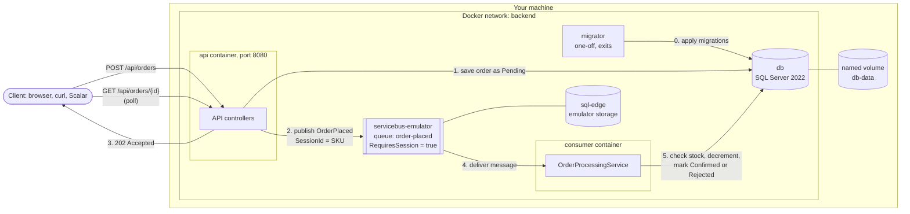

# Dockerisation, explained

This document explains the Dockerisation work on the `feature/dockerisation` branch (Stage 4, Part 1), written for someone new to Docker. Everything here was checked against the real code on the branch. Where something from the brief is **not** on the branch, it says so plainly.

- Branch: `feature/dockerisation`
- Base used for comparison: `origin/main` (the Service Bus work was merged into it in PR #5, so `git diff origin/main...feature/dockerisation` shows only the Dockerisation work). A local `main` that has not been pulled can be many commits behind, so compare against `origin/main`
- Size: 12 commits, 27 files changed for the first pass; the gap-closing work (separate consumer, migrator service, test queue, scripts) was added afterwards on `feature/stage4-gaps-cicd-observability`

> **Read this first: what is and is not done**
>
> | Brief step | Status |
> |---|---|
> | 1. Config from env vars + `.env.example` | Done |
> | 2. `/health/live` and `/health/ready` | Done |
> | 3. Separate API and Consumer | Done: `Api:Enabled` / `Consumer:Enabled` switches, one image, a `consumer` compose service |
> | 4. `.dockerignore` | Done |
> | 5. Multi-stage Dockerfile | Done |
> | 6. Non-root container | Done (api, consumer and migrator all run as `app`, uid 1654) |
> | 7. Compose file with api, consumer, db, emulator | Done: `compose.yaml` with api, consumer, migrator, db, emulator |
> | 8. Migrations before the API serves traffic | Done with a one-off `migrator` service (EF Core migration bundle) |
> | 9. Start-up order with health checks | Done (db health, migrator completion, emulator probe) |
> | 10. End-to-end check incl. stopping only the consumer | Done: `scripts/e2e-consumer-recovery.ps1` and `scripts/smoke-test.ps1` |
>
> Earlier versions of this document listed steps 3, 7, 8 and 10 as not done. They have since been implemented and verified; the sections below describe the current state.

---

## 1. The big picture

**The problem Docker solves here.** To run this project you need the .NET 10 SDK, a SQL Server, and an Azure Service Bus. Each developer would have to install and configure all of that, and "it works on my machine" problems follow. Docker packages each piece with everything it needs, so one command starts the whole system the same way on any machine.

**Four words to know:**

- **Image**: a read-only package containing an app and everything it needs to run (files, runtime, settings). Think of it as a **recipe card plus pre-measured ingredients, sealed in a box**.
- **Container**: a running instance of an image. If the image is the sealed box, the container is **the meal cooked from it**. You can cook many meals from one box, and throwing a meal away does not damage the box.
- **Registry**: a place that stores images so others can download them, like an app store for images. Docker Hub and Microsoft's `mcr.microsoft.com` are registries. This project *pulls* images from `mcr.microsoft.com` but does not *push* its own image anywhere yet.
- **Compose**: a tool that reads one file describing several containers (the API, the database, the emulator) and starts them together, wired to each other. It is the **head chef** coordinating several cooks.

---

## 2. The brief, step by step

### Step 1: Config from environment variables and `.env.example`

**What was done.** Every setting the app needs can be supplied by an environment variable (a named value the operating system hands to a program when it starts). ASP.NET Core maps a variable like `Jwt__Key` to the setting `Jwt:Key` (double underscore means "go one level deeper").

Each config section has its own **options class** (a small C# class whose properties mirror the settings), with a `Path` constant naming its section:

| Options class | Section | Validated |
|---|---|---|
| `Configuration/DatabaseOptions.cs` | `Database` (`ConnectionString`) | Connection string required |
| `Configuration/JwtOptions.cs` | `Jwt` | Issuer and audience required, key at least 32 characters, expiry 1 to 1440 minutes |
| `Configuration/ServiceBusOptions.cs` | `ServiceBus` | Connection string and queue name required |
| `Configuration/HealthCheckSettingsOptions.cs` | `HealthChecks` | Timeout 1 to 120 seconds |
| `Configuration/SeedAdminOptions.cs` | `SeedAdmin` | Valid email, password required |
| `Configuration/ApiOptions.cs` | `Api` (`Enabled`, default true) | Both roles off is rejected at startup |
| `Configuration/ConsumerOptions.cs` | `Consumer` (`Enabled`, default true) | Both roles off is rejected at startup |

They are bound in the extension methods, for example `Extensions/DatabaseServiceExtensions.cs` lines 12 to 15:

```csharp
services.AddOptions<DatabaseOptions>()
    .Bind(configuration.GetSection(DatabaseOptions.Path))
    .ValidateDataAnnotations()
    .ValidateOnStart();
```

`ValidateOnStart` means a bad value stops the app at startup with a clear message, instead of failing later on the first request.

**Secrets** go in a file called `.env`, which is listed in `.gitignore` (line 9) so it is never committed. The committed `.env.example` shows which variables are needed, with safe placeholder values. `compose.yaml` reads `.env` and uses `${VAR:?message}`, which makes compose refuse to start if a required value is missing.

**Why this way.** Secrets must never be in Git or baked into an image. Options classes replace "magic strings" like `Configuration["Jwt:Key"]` scattered through the code, and validation catches mistakes early.

**Prove it:**

```powershell
# With no .env file, compose refuses to start and names the missing variable
Rename-Item .env .env.bak; docker compose config; Rename-Item .env.bak .env

# A too-short JWT key makes the app fail at startup (covered by a test)
dotnet test --filter "FullyQualifiedName~InvalidConfiguration_FailsAtStartup"
```

### Step 2: `/health/live` and `/health/ready`

**What was done.** Two endpoints, registered in `Extensions/HealthCheckServiceExtensions.cs` and mapped in `Extensions/HealthCheckEndpointExtensions.cs`.

- `/health/live` answers "is the process running?". It runs only a `self` check that always passes (line 25). It does **not** check the database, on purpose.
- `/health/ready` answers "can this instance do useful work right now?". It runs:
  - `database` (`HealthChecks/DatabaseHealthCheck.cs`): can we open a connection to SQL Server?
  - `servicebus-order-queue` (`HealthChecks/ServiceBusHealthCheck.cs`): can we attach to the `order-placed` queue?

Each check is **tagged** `live` or `ready`, and each endpoint only runs checks with its tag (`HealthCheckEndpointExtensions.cs` lines 13 and 19). The timeout per check comes from `HealthChecks:TimeoutSeconds` (default 5), applied in lines 37 to 48. Responses are JSON and never include exception messages, because these endpoints need no login and error text can leak server names.

**Why this way.** If liveness checked the database, a database outage would make an orchestrator restart every API container, which fixes nothing. Readiness is the right place for dependency checks: "don't send me traffic yet".

**Prove it:**

```powershell
curl.exe -s -w " HTTP %{http_code}`n" http://localhost:8080/health/live
curl.exe -s -w " HTTP %{http_code}`n" http://localhost:8080/health/ready
```

Both return `HTTP 200` when everything is up. This was also verified with `dotnet run` against LocalDB before containerising.

### Step 3: Separate API and Consumer

**What was done.** The same project and the same image can run in two roles, chosen by configuration:

| Setting | Default | Effect when `false` |
|---|---|---|
| `Api:Enabled` | `true` | No controllers, authentication, Scalar or seeding. Only the health endpoints are served |
| `Consumer:Enabled` | `true` | `OrderProcessingService` is not registered, so no messages are read |

Both default to `true`, so `dotnet run` and the tests behave as before. Compose sets `Consumer__Enabled=false` on `api` and `Api__Enabled=false` on `consumer`. `Extensions/AppRoleExtensions.cs` reads both and **throws** `InvalidOperationException` if both are false (guard clause). `Program.cs` calls `AddApiServices` and `UseApiPipelineAsync` only when the API role is on.

**Why this way, and not a Worker Service project.** The consumer needs the same `AppDbContext`, models and messaging code as the API. A second project would mean either extracting a shared library or copying code, and a second Dockerfile. For this size of system, one image with two roles is simpler and keeps the business code untouched. The trade-off is that one binary contains both jobs, so each role registers only what it needs: the consumer has no controllers and needs no JWT key.

**Prove it:**

```powershell
docker compose up -d --wait api consumer
docker compose ps                                        # api and consumer are separate containers
dotnet test --filter "FullyQualifiedName~AppRoleTests"   # both disabled fails; api-only and consumer-only behave
```

### Step 4: `.dockerignore`

**What was done.** `.dockerignore` lists files Docker must not send to the build. When you run `docker build`, Docker first copies the folder (the **build context**) to the build engine; this file trims it.

It excludes:
- `bin/`, `obj/`: local build output (can be large and machine-specific)
- `.git/`, `.vs/`, `.vscode/`, `.idea/`: history and editor files
- `Ecommerce_Backend.Tests/`: the test project, which must never end up in the image
- `.env`, `.env.*`, `secrets.json`, `*.pfx`, `*.mdf`, `*.ldf`: local secrets and database files
- the Dockerfile, compose file and README (not needed inside the image)

It is plain UTF-8 without a BOM (a hidden marker at the start of some files). A BOM can silently break the first pattern in the file.

**Small gap:** test results folders (`TestResults/`) are not listed by name. They are already excluded because they live inside the excluded test project, but if a senior asks, that is the honest answer.

**Prove it:** `Get-Content .dockerignore -Encoding Byte -TotalCount 3` shows `35 32 66` (`# B`), not `239 187 191` (a BOM).

### Step 5: Multi-stage Dockerfile

**What was done.** The Dockerfile has two stages (explained line by line in section 3):

1. **build** stage, from the large .NET SDK image: restores packages and publishes the API.
2. **final** stage, from the small ASP.NET runtime image: receives **only** the published output.

The final image has no SDK, no source code, and no test project. The `csproj` is copied and restored before the rest of the code, so Docker can reuse the restore step from its cache when only `.cs` files change.

**Prove it:**

```powershell
docker compose build api
docker run --rm --entrypoint ls ecommerce-backend-api:local /app            # only .dll/.json files
docker run --rm --entrypoint ls ecommerce-backend-api:local /usr/share/dotnet/sdk   # fails: no SDK
docker images ecommerce-backend-api:local                                    # compare size with the SDK image
```

### Step 6: Non-root container

**What was done.** Dockerfile line 28, `USER $APP_UID`. The official .NET 8+ images ship with a user called `app` (user id 1654) that has no admin rights. Switching to it before `ENTRYPOINT` means the app never runs as `root`.

**Why.** If someone found a security hole in the app, they would control the process. As `root` they could do much more damage inside the container and have a better chance of escaping it.

**Prove it (verified):**

```powershell
docker compose exec api id
# uid=1654(app) gid=1654(app) groups=1654(app)
```

### Step 7: The compose file

**What was done.** `compose.yaml` defines these services:

| Service | What it is |
|---|---|
| `migrator` | One-off job that applies the EF Core migrations, then exits |
| `api` | Our app in the HTTP API role (`Consumer__Enabled=false`) |
| `consumer` | The same image in the consumer role (`Api__Enabled=false`) |
| `db` | SQL Server 2022 for the app's data, with named volume `db-data` |
| `sql-edge` | A separate small SQL engine that the Service Bus emulator needs to store its own state |
| `servicebus-emulator` | Microsoft's local Service Bus, so no Azure subscription is needed |
| `servicebus-emulator-ready` | A tiny one-shot container that waits until the emulator answers, then exits |

The queues are defined in `docker/servicebus-emulator/Config.json`: `order-placed` with `"RequiresSession": true` (sessions make all messages for one SKU go to one consumer in order, which is how the async buy flow avoids overselling), and `order-placed-tests`, an identical queue used only by the integration tests (see section 5).

The file is named `compose.yaml` (the name Compose itself prefers). The api and consumer share one `build:` block through a YAML anchor, so both use the same image.

### Step 8: Migrations before the API serves traffic

**What was done.** A separate `migrator` service. The Dockerfile has two extra stages:

1. `migrations-build` runs `dotnet ef migrations bundle`, which produces **one self-contained executable** that applies every migration. The `dotnet-ef` version is pinned in `dotnet-tools.json`.
2. `migrator` copies only that executable into a small `runtime-deps` image (no SDK, no source, no app) and runs as the non-root user.

In `compose.yaml` the migrator receives the database connection string and runs `./efbundle --connection "$Database__ConnectionString"`. Both `api` and `consumer` have `depends_on: migrator: condition: service_completed_successfully`, so they only start after the migrator exits with code 0. If a migration fails, the migrator exits non-zero and the stack stops there instead of crash-looping the API.

The API no longer migrates itself: `Database:MigrateOnStartup` and `DatabaseMigrationExtensions.cs` were removed.

**Why this is better.** Schema changes are a deliberate step with their own container and could use their own credentials, instead of a side effect of starting a web server. With several API replicas only one job changes the schema. (In this local stack all services still use the `sa` account, so the "least privilege" benefit is not yet realised.)

**Prove it (verified from an empty volume):**

```powershell
docker compose down -v; docker compose up -d --wait api consumer
docker compose logs migrator | Select-String "Done"
docker compose ps -a   # migrator Exited (0), api and consumer Up
```

### Step 9: Start-up order using health checks

**What was done.** In `compose.yaml`, `api` and `consumer` both have:

```yaml
depends_on:
  db:
    condition: service_healthy
  migrator:
    condition: service_completed_successfully
  servicebus-emulator-ready:
    condition: service_completed_successfully
```

The `migrator` itself waits for `db` to be healthy. So the order is: db healthy, then migrations, then api and consumer.

- `db` is **healthy** only once `sqlcmd` can actually run `SELECT 1` (line 47), not just when the container starts. SQL Server takes 10 to 30 seconds to be usable after its container starts.
- The emulator image has **no shell or curl inside it** (a "distroless" image), so it cannot run a health check. Instead `servicebus-emulator-ready` (a curl container) polls `http://servicebus-emulator:5300/health` and exits with success once it gets a 200. The API waits for that exit.

**Prove it:**

```powershell
docker compose down -v; docker compose up --build -d --wait api consumer
docker compose ps -a   # db (healthy), migrator and servicebus-emulator-ready Exited (0), api and consumer Up
```

### Step 10: End-to-end check

**Two scripts under `scripts/`** (PowerShell, they read the admin login from `.env`):

- `scripts/smoke-test.ps1` is the Container Smoke Test. Positive: starts the stack, waits for `/health/ready` to return 200, creates a product through the admin API and expects `GET /api/products/{id}` to return 200. Negative: stops only `db` and expects `/health/ready` to return 503 while `/health/live` stays 200. It tears the stack down at the end. The brief says "a seeded product", but the app seeds no products, so the script creates one first.
- `scripts/e2e-consumer-recovery.ps1` is the end-to-end check. It buys (202 Accepted, status `0` Pending), waits for `1` Confirmed, then **stops only the consumer container**, buys 3 more (they stay Pending), starts the consumer, and checks all 3 become Confirmed and stock dropped by exactly 4 in total (no double processing). The emulator is never restarted, because that would lose waiting messages.

**Verified results (both scripts exit 0):** the purchase was confirmed; with only the consumer stopped the 3 orders stayed Pending and were all Confirmed after restart with stock `10 - 4 = 6`; with only the database stopped `/health/ready` returned 503 and `/health/live` 200.

The same recovery behaviour is also covered by the integration test `ConsumerRecovery_PendingOrdersResolveExactlyOnceAfterProcessorRestart` in `OrdersControllerTests.cs`.

> Status values in JSON are numbers: `0` Pending, `1` Confirmed, `2` Rejected, `3` Cancelled. That serialization predates this branch.

---

## 3. Line by line

### Dockerfile

```dockerfile
# syntax=docker/dockerfile:1
```
Tells Docker which version of the Dockerfile language to use.

```dockerfile
FROM mcr.microsoft.com/dotnet/sdk:10.0 AS build
WORKDIR /src
```
Start the first stage from Microsoft's .NET 10 SDK image (has the compiler) and name the stage `build`. Work inside folder `/src`.

```dockerfile
COPY dotnet-tools.json ./
COPY Ecommerce_Backend/Ecommerce_Backend.csproj Ecommerce_Backend/
RUN dotnet restore Ecommerce_Backend/Ecommerce_Backend.csproj && dotnet tool restore
```
Copy **only the project file** and the tool manifest, then download NuGet packages and the pinned `dotnet-ef` tool. Docker caches each step as a **layer**; if these files have not changed, this slow step is reused from cache on the next build.

```dockerfile
COPY Ecommerce_Backend/ Ecommerce_Backend/
RUN dotnet publish Ecommerce_Backend/Ecommerce_Backend.csproj \
    --configuration Release --no-restore --output /app/publish -p:UseAppHost=false
```
Copy the rest of the API source, then compile it in Release mode into `/app/publish`. `--no-restore` reuses the packages from the previous step. `UseAppHost=false` skips building a native launcher we do not need. Only the API project is copied, so the test project can never get in.

```dockerfile
FROM build AS migrations-build
ARG TARGETARCH
RUN case "$TARGETARCH" in arm64) RID=linux-arm64 ;; *) RID=linux-x64 ;; esac \
    && dotnet ef migrations bundle ... --self-contained --target-runtime "$RID" --output /app/efbundle --force
```
A stage built on top of `build` that produces the **migration bundle**: one executable that carries the .NET runtime and every migration. It picks the CPU type (x64 or arm64) from the build platform.

```dockerfile
FROM mcr.microsoft.com/dotnet/runtime-deps:10.0 AS migrator
COPY --from=migrations-build /app/efbundle .
ENV DOTNET_BUNDLE_EXTRACT_BASE_DIR=/tmp
USER $APP_UID
ENTRYPOINT ["./efbundle"]
```
The **migrator** image: a tiny base with only the native libraries a self-contained app needs (no SDK, no ASP.NET), the bundle, and the non-root user. The bundle unpacks a few files at start-up, so `/tmp` is given as the place to do it.

```dockerfile
FROM mcr.microsoft.com/dotnet/aspnet:10.0 AS final
WORKDIR /app
COPY --from=build /app/publish .
```
Start a **fresh** stage from the much smaller ASP.NET runtime image (can run apps, cannot compile them). Copy in only the published output from the `build` stage. This is the last stage, so a plain `docker build` produces it; the migrator is selected with `target: migrator` in compose.

```dockerfile
ENV ASPNETCORE_HTTP_PORTS=8080
EXPOSE 8080
```
The app listens on port 8080 inside the container. `EXPOSE` is documentation; the actual mapping to your machine is in the compose file.

```dockerfile
USER $APP_UID
ENTRYPOINT ["dotnet", "Ecommerce_Backend.dll"]
```
Switch to the non-root `app` user, then define the command that runs when a container starts.

### compose.yaml

```yaml
name: ecommerce-backend
```
Project name. Containers, the network and the volume get this prefix.

```yaml
x-app-build: &app-build { context: ., dockerfile: Dockerfile }
x-database-connection: &database-connection { Database__ConnectionString: "Server=db,1433;...Password=${DB_SA_PASSWORD:?...};..." }
x-servicebus-connection: &servicebus-connection { ServiceBus__ConnectionString: ${SERVICEBUS_CONNECTION_STRING:?...} }
```
Reusable blocks (YAML anchors, the `&name` part) so the build settings and the two connection strings are written once and merged into several services with `<<: *name`. `Server=db` uses the service name as a hostname (see section 4). `:?` makes compose stop with an error if a value is missing from `.env`.

**`migrator`**
```yaml
build: { <<: *app-build, target: migrator }
entrypoint: [sh, -c, 'exec ./efbundle --connection "$$Database__ConnectionString"']
depends_on: { db: { condition: service_healthy } }
restart: "no"
```
Build the `migrator` stage of the Dockerfile. Run the bundle with the connection string taken from the environment (`$$` is how you write a literal `$` in compose). Wait for a healthy database, and never restart: it is meant to run once and exit.

**`api`**
```yaml
build: *app-build
image: ecommerce-backend-api:local
ports: ["${API_PORT:-8080}:8080"]
```
Build the image from the Dockerfile and tag it `ecommerce-backend-api:local`. Map port 8080 on your machine (or `API_PORT` from `.env`) to 8080 in the container.
```yaml
environment:
  ASPNETCORE_ENVIRONMENT: Development
  Consumer__Enabled: "false"
  Jwt__Key: ${JWT_KEY:?...}
  SeedAdmin__Email / SeedAdmin__Password: ...
```
Runs in Development so the Admin and User roles plus a default admin are seeded and the Scalar API docs are available (fine for a local stack, **not** for production). `Consumer__Enabled=false` turns the consumer off in this container. The connection strings are merged in from the anchors.
```yaml
depends_on: { db: service_healthy, migrator: service_completed_successfully, servicebus-emulator-ready: service_completed_successfully }
restart: on-failure:3
```
Start only after the database is healthy, the migrations are applied and the emulator probe succeeded. If the app crashes, retry up to 3 times.

**`consumer`**: the same image and build as `api`, with `Api__Enabled=false`. No published port, no JWT key and no seed settings, because it serves no API. Same `depends_on` and restart policy.

**`db`**
```yaml
image: mcr.microsoft.com/mssql/server:2022-latest
environment: { ACCEPT_EULA: "Y", MSSQL_PID: Developer, MSSQL_SA_PASSWORD: ${DB_SA_PASSWORD:?...} }
ports: ["${DB_PORT:-1433}:1433"]
volumes: [db-data:/var/opt/mssql]
```
SQL Server 2022, free Developer edition, admin password from `.env`, reachable from your machine on 1433 (handy for SQL tools), data stored in the named volume `db-data`.
```yaml
healthcheck:
  test: [... sqlcmd ... -Q "SELECT 1" ...]
  interval: 10s, timeout: 5s, retries: 10, start_period: 30s
```
Every 10 seconds, run a real query. Allow 30 seconds of warm-up before failures count.

**`sql-edge`**: Azure SQL Edge, used **only** by the emulator to store its queues and messages. Not the app's database.

**`servicebus-emulator`**
```yaml
volumes: ["./docker/servicebus-emulator/Config.json:/ServiceBus_Emulator/ConfigFiles/Config.json:ro"]
ports: ["5672:5672", "5300:5300"]
environment: { ACCEPT_EULA: "Y", SQL_SERVER: sql-edge, MSSQL_SA_PASSWORD: ... }
```
Mount our queue definitions read-only into the emulator. 5672 is the AMQP messaging port (AMQP is the protocol Service Bus speaks), 5300 is its management and health port. Both are published on your machine so the integration tests can use the emulator. It finds its store at hostname `sql-edge`.

**`servicebus-emulator-ready`**
```yaml
image: curlimages/curl:8.11.1
command: [--silent, --fail, --output, /dev/null, --max-time, "5", --retry, "60", --retry-delay, "2", --retry-all-errors, http://servicebus-emulator:5300/health]
```
Run curl against the emulator's health URL, retrying up to 60 times, 2 seconds apart. Exit code 0 means ready, and that unblocks `api` and `consumer`.

**Bottom of the file**
```yaml
volumes: { db-data: }
networks: { backend: }
```
Declare the named volume and the private network.

---

---

## 4. How the running system works



**Start-up order:** `db` becomes healthy, the `migrator` applies the migrations and exits, and only then do `api` and `consumer` start.

**A purchase, in words:** the API saves the order as Pending, puts a message on the `order-placed` queue, and answers `202 Accepted` straight away. The consumer picks up the message, checks and decrements stock, and marks the order Confirmed or Rejected. The client polls the order until its status changes.

**How containers find each other.** Compose creates a private network (`backend`) and gives every service a hostname equal to its service name. Docker runs a small DNS server (a "phone book" that turns names into addresses) on that network. So the API connects to `Server=db,1433`, and to `sb://servicebus-emulator`, without knowing any IP address. From **your** machine you use `localhost:8080`, because of the `ports:` mappings.

**How data persists.** A container's own filesystem is thrown away when the container is removed. The database writes to `/var/opt/mssql`, which is mounted from the **named volume** `db-data`, a storage area Docker manages outside any container. So `docker compose down` then `up` keeps your data; `docker compose down -v` deletes the volume and you start fresh. The emulator's `sql-edge` has **no** volume, so queue state is not kept if that container is recreated.

**How config and secrets get in.** `.env` (on your machine, never committed) → compose substitutes the values into `environment:` → the container sees them as environment variables → ASP.NET Core maps `A__B` to `A:B` → options classes are bound and validated. Secrets are never written into the image, so the same image could run anywhere with different secrets.

---

## 5. What changed in the existing code and why

| File | Why |
|---|---|
| `Ecommerce_Backend/Program.cs` | Shrunk to a list of extension method calls; the API pieces run only when the API role is on |
| `Ecommerce_Backend/Configuration/DatabaseOptions.cs` (new) | Connection string as a validated options class |
| `Ecommerce_Backend/Configuration/ApiOptions.cs`, `ConsumerOptions.cs` (new) | The two role switches |
| `Ecommerce_Backend/Extensions/AppRoleExtensions.cs` (new) | Reads the role switches and throws if both are off |
| `Ecommerce_Backend/Extensions/ApiServiceExtensions.cs`, `ApiPipelineExtensions.cs` (new) | Everything only the HTTP API needs (controllers, auth, seeding, Scalar) |
| `Ecommerce_Backend/Configuration/JwtOptions.cs` (new) | JWT settings validated at startup (key length, expiry range) |
| `Ecommerce_Backend/Configuration/SeedAdminOptions.cs` (new) | Seed admin settings as options instead of magic strings |
| `Ecommerce_Backend/Configuration/HealthCheckSettingsOptions.cs` (new) | Configurable health check timeout |
| `Ecommerce_Backend/Configuration/ServiceBusOptions.cs` | Added `Path` and required-field validation |
| `Ecommerce_Backend/Extensions/*ServiceExtensions.cs` (new, 6 files) | One extension method per concern: database, auth, Service Bus, app services, health checks, seeding |
| `Ecommerce_Backend/Extensions/HealthCheckEndpointExtensions.cs` (new) | Maps `/health/live` and `/health/ready`, JSON response without exception details |
| `Ecommerce_Backend/HealthChecks/DatabaseHealthCheck.cs` (new) | Database readiness check that respects the timeout and does not leak error text |
| `Ecommerce_Backend/HealthChecks/ServiceBusHealthCheck.cs` (new) | Queue readiness check that really detects a broker outage |
| `Ecommerce_Backend/Messaging/ServiceBusOrderEventPublisher.cs` | Receives a keyed `ServiceBusSender` (one shared sender per queue) instead of creating its own |
| `Ecommerce_Backend/Services/TokenService.cs` | Reads `IOptions<JwtOptions>` instead of `IConfiguration["Jwt:..."]` |
| `Ecommerce_Backend/appsettings.json` | Connection string moved to `Database:ConnectionString`; added `Database` and `HealthChecks` sections |
| `Ecommerce_Backend.Tests/HealthChecks/HealthCheckEndpointTests.cs` (new) | Tests for both endpoints and for fail-fast config validation |
| `Ecommerce_Backend.Tests/Roles/AppRoleTests.cs` (new) | Both roles off fails; API-only and consumer-only behave |
| `Ecommerce_Backend.Tests/CustomWebApplicationFactory.cs` | Tests use their own `order-placed-tests` queue |
| `docker/servicebus-emulator/Config.json` | Added the `order-placed-tests` queue |
| `dotnet-tools.json` (new) | Pins the `dotnet-ef` version for the Dockerfile and CI |
| `scripts/` (new) | `smoke-test.ps1`, `e2e-consumer-recovery.ps1` and a shared helper |
| `Dockerfile`, `.dockerignore`, `compose.yaml`, `.env.example` (new or rewritten) | The Docker setup (`docker-compose.yml` was renamed to `compose.yaml`) |
| `.gitattributes` (new) | Forces Linux line endings on Docker files (Windows line endings can break a Dockerfile) |
| `.gitignore` | Ignores `.env`; removed a hidden BOM at the start of the file |
| `README.md` | Documents the compose stack, health checks and config settings |

**Business behaviour:** no controller, service or model logic changed. `OrderProcessingService` itself is unchanged; it is now only registered when `Consumer:Enabled` is true. The buy flow is the same: save as Pending, publish, consume, Confirm or Reject.

**Breaking config change:** the connection string key moved from `ConnectionStrings:DefaultConnection` to `Database:ConnectionString`. Anyone who had a user secret under the old key must set it again.

**Tests (last full run, emulator and the api and consumer containers running):** 105 passed, 0 failed.

**The five failures from the first pass were reproduced and their cause confirmed.** With the `api` container running, 5 order tests failed (97 passed): `Buy_AsAuthenticatedUser_AcceptsThenConfirmsAndReducesStock`, `Buy_ConcurrentRequestsExceedingStock_ConfirmsExactlyAvailableQuantity`, `Buy_MoreThanAvailableStock_ResolvesToRejectedAndDoesNotChangeStock`, `Buy_UsesVariantPriceOverrideWhenSet` and `ConsumerRecovery_PendingOrdersResolveExactlyOnceAfterProcessorRestart`. Each waited about 30 seconds and then failed because its order never left Pending. With `docker compose stop api`, all 9 order tests passed in 10 seconds.

**Cause:** the tests and the container both consumed from the same `order-placed` queue. When the container won a message, it looked for the order in its own SQL Server database, did not find it, and (by design) completed the message without doing anything. The test's order, which lives in the test's in-memory database, stayed Pending forever.

**Fix:** the integration tests now use their own queue, `order-placed-tests` (defined in the emulator config and set in `CustomWebApplicationFactory`). A running stack no longer interferes: 102 of 102 tests passed with the `api` container up, and 105 of 105 after the role tests were added. A fake in-process broker was rejected because it would not exercise real Service Bus sessions; stopping the stack before every test run was rejected because it is easy to forget.

---

## 6. Design decisions and trade-offs

**Why the consumer is separate.** An API and a consumer do different jobs with different load. Separated, you can run 3 API containers and 1 consumer, restart the consumer without dropping web requests, and prove that orders placed while the consumer is down are processed later (`scripts/e2e-consumer-recovery.ps1`). They still share one image and one code base, selected by `Api:Enabled` and `Consumer:Enabled`.

**Why migrations are a one-off service, not run on every API start.** Picture 3 API replicas starting at the same moment, each trying to change the database schema. EF Core 9+ takes a database lock (`sp_getapplock` on `__EFMigrationsLock`) so that is *safe*, but still not ideal:
- every replica needs permission to change the schema (more privilege than an app should have)
- startup gets slower and a failed migration crash-loops every replica
- schema changes become a side effect of "starting the web server" instead of a deliberate step

The migrator runs once, and the API and consumer wait for it to finish successfully.

**Why the emulator must not be restarted during the recovery test.** The recovery test is about the **consumer** being down while messages wait safely in the queue. The emulator keeps its state in `sql-edge`, which has no volume here, so recreating those containers can lose waiting messages. Restarting the emulator would test a different (and on a real Azure Service Bus, impossible) scenario. *This message-loss behaviour comes from the brief; it was not tested on this branch.* The recovery script therefore stops and starts only the `consumer` container.

**Which database and why: SQL Server.** The EF Core provider (`Microsoft.EntityFrameworkCore.SqlServer`) and all 7 existing migrations target SQL Server. Product search and the uniqueness checks rely on SQL Server's case-insensitive default comparison. PostgreSQL has a much smaller image and an excellent EF provider (Npgsql), but switching would mean regenerating every migration and changing search and uniqueness behaviour. The `sql-edge` container is separate and required by the emulator whatever database the app uses.

**Why a probe container for the emulator.** The emulator image contains no shell, so compose cannot run a health check inside it. Polling its `/health` URL from a tiny curl container is the workaround.

---

## 7. Orchestration

**Orchestration** means automatically starting, connecting, watching and managing many containers.

**What compose does here, as a small orchestrator:**
- builds the API image and pulls the others
- creates the private network and the named volume
- injects config from `.env`
- starts services in the right order using health checks (`service_healthy`, `service_completed_successfully`)
- restarts the API up to 3 times if it crashes (`restart: on-failure:3`)

**What Kubernetes would do instead (or in addition):**

| Kubernetes feature | Meaning | In this project |
|---|---|---|
| Scheduling | Decides which machine in a cluster runs each container | Compose only uses one machine |
| Self-healing | Replaces crashed containers and moves them off dead machines | Compose only retries a crashed container on the same machine |
| Scaling | Runs N copies behind a load balancer, even automatically by CPU | Compose can `--scale`, but our fixed host port 8080 would clash and there is no load balancer |
| Rolling updates | Replaces old containers with new ones a few at a time, no downtime | Compose stops and recreates |
| Liveness probe | Restart the container if this fails | Would point at `/health/live` |
| Readiness probe | Stop sending traffic if this fails, but don't restart | Would point at `/health/ready` |
| Secrets objects | Stores secrets separately from config, mounted at runtime | Compose uses a plain `.env` file |

**What compose does NOT do:** run across several machines, load-balance between replicas, roll out updates without downtime, restart unhealthy (but still running) containers, or manage secrets securely. Compose health checks only decide **start-up order**; after that, a container that turns unhealthy is not restarted.

---

## 8. Limitations and honest gaps

**Things to be careful not to over-claim:**
- The migrator and the other services all connect as `sa`, so the "migrations use their own, more privileged credentials" benefit is not realised yet.
- The smoke test creates its own product, because the app seeds none.
- The consumer has no compose health check (the runtime image has no curl). Its `/health/ready` exists inside the network but is not polled.

**Emulator limitations hit or observed:**
- The emulator image is distroless (no shell), so it cannot have a compose health check; a curl probe container is used instead.
- It does not shut down on a normal stop signal: `docker compose stop servicebus-emulator` waits and then kills it (exit code 137).
- After the first successful attach, the Service Bus SDK caches queue information, so a naive health check kept saying Healthy with the emulator stopped. The check now opens a fresh link each time.
- `sql-edge` has no volume, so emulator state does not survive the container being recreated.
- Azure SQL Edge has been retired by Microsoft, but the emulator setup still uses it.
- The emulator only accepts its fixed development key (`SAS_KEY_VALUE`) and is for local development only.

**Not production-ready:**
- The API container runs with `ASPNETCORE_ENVIRONMENT=Development` (seeded admin, Scalar docs exposed).
- The app connects to SQL Server as `sa` (the all-powerful admin account) and uses `TrustServerCertificate=True` (skips certificate checks).
- `appsettings.Development.json`, containing a placeholder JWT key, is copied into the image. Compose overrides it with `JWT_KEY`, but it is still inside the image.
- Image tags `latest` and `2022-latest` are not pinned, so builds can change over time.
- SQL Server (1433) and the emulator (5672, 5300) ports are published on your machine.
- No health check on the `api` or `consumer` containers in compose (the runtime image has no curl), and no CPU or memory limits.
- Secrets live in a plain `.env` file.

---

## 9. Demo script (PowerShell, from a clean clone)

Docker Desktop must be running.

```powershell
# 1. Get the code
git clone https://github.com/BirasaDivine/Ecommerce_Backend.git
cd Ecommerce_Backend
git checkout feature/dockerisation
```
*Say:* "Everything runs from this repo; no SDK, database or Azure account needed on the machine except Docker."

```powershell
# 2. Secrets
Copy-Item .env.example .env
notepad .env   # set the passwords and a 32+ character JWT_KEY
```
*Say:* "Secrets live in `.env`, which Git ignores. The example file only has placeholders."

```powershell
# 3. Start everything
docker compose up --build -d --wait api consumer
docker compose ps -a
```
*Expect:* `db` healthy, `migrator` and `servicebus-emulator-ready` Exited (0), `api` and `consumer` Up. First run downloads about 2 GB of images.
*Say:* "The API waited until SQL Server could answer a query and the emulator answered its health URL."

```powershell
# 4. Migrations and non-root
docker compose logs migrator | Select-String "Done"
docker compose logs api | Select-String "Now listening"
docker compose exec api id
```
*Expect:* the migrator log ends with `Done.`, then the API says `Now listening`. `uid=1654(app)`.

```powershell
# 5. Health
curl.exe -s -w " HTTP %{http_code}`n" http://localhost:8080/health/live
curl.exe -s -w " HTTP %{http_code}`n" http://localhost:8080/health/ready
```
*Expect:* both `HTTP 200`; ready lists `database` and `servicebus-order-queue` as Healthy.

```powershell
# 6. Buy flow (use the SEED_ADMIN_* values from your .env)
$api = "http://localhost:8080"
$adminEmail = "admin@ecommerce.local"; $adminPassword = "<SEED_ADMIN_PASSWORD from .env>"

Invoke-RestMethod -Method Post "$api/api/auth/register" -ContentType "application/json" -Body (@{ email = "buyer@example.com"; password = "Buyer123!" } | ConvertTo-Json)
$userToken  = (Invoke-RestMethod -Method Post "$api/api/auth/login" -ContentType "application/json" -Body (@{ email = "buyer@example.com"; password = "Buyer123!" } | ConvertTo-Json)).token
$adminToken = (Invoke-RestMethod -Method Post "$api/api/auth/login" -ContentType "application/json" -Body (@{ email = $adminEmail; password = $adminPassword } | ConvertTo-Json)).token
$admin = @{ Authorization = "Bearer $adminToken" }; $user = @{ Authorization = "Bearer $userToken" }

$category = Invoke-RestMethod -Method Post "$api/api/categories" -Headers $admin -ContentType "application/json" -Body (@{ name = "Shirts" } | ConvertTo-Json)
$product  = Invoke-RestMethod -Method Post "$api/api/products" -Headers $admin -ContentType "application/json" -Body (@{ name = "Docker Tee"; description = "demo"; basePrice = 25; material = "cotton"; categoryId = $category.id; variants = @(@{ name = "M"; sku = "DT-M-$(Get-Random)"; quantity = 5 }) } | ConvertTo-Json -Depth 5)
$variantId = (Invoke-RestMethod "$api/api/products/$($product.id)").variants[0].id

$order = Invoke-RestMethod -Method Post "$api/api/orders" -Headers $user -ContentType "application/json" -Body (@{ variantId = $variantId; quantity = 2 } | ConvertTo-Json)
$order.status   # 0 = Pending
Start-Sleep 2
(Invoke-RestMethod "$api/api/orders/$($order.id)" -Headers $user).status   # 1 = Confirmed
```
*Say:* "The API answered immediately with Pending (202). The consumer processed the queue message and confirmed it."

```powershell
# 7. Readiness reacts to a dead dependency
docker compose stop db
curl.exe -s -w " HTTP %{http_code}`n" http://localhost:8080/health/ready   # 503 after ~5 s
curl.exe -s -w " HTTP %{http_code}`n" http://localhost:8080/health/live    # still 200
docker compose start db
```
*Say:* "Ready says 'don't send me traffic', live says 'I'm alive, don't restart me'. A database outage should not restart the API."

```powershell
# 7b. Stop only the consumer (the emulator must stay up), buy, restart
./scripts/e2e-consumer-recovery.ps1
```
*Say:* "The consumer is its own container. While it is stopped, orders are accepted and stay Pending; after it restarts they are all processed exactly once."

```powershell
# 8. Clean up (-v also deletes the database volume)
docker compose down -v
```

---

## 10. Likely questions from seniors

1. **Why multi-stage?** The SDK is needed to compile but not to run. The final image only has the runtime and our DLLs: smaller, faster to pull, and less software for an attacker to use.
2. **Why non-root?** If the app is compromised, the attacker gets only an unprivileged user inside the container, not root, which limits damage and makes escaping harder.
3. **Why copy the csproj and restore before copying the code?** Layer caching: package restore only reruns when the csproj changes, not on every code edit.
4. **What happens if the database is slow to start?** The API does not start until the `db` health check passes (`SELECT 1` succeeds), with 30 seconds of warm-up and 10 retries. If migrations still fail, the API exits and compose retries it up to 3 times.
5. **What happens with 3 API replicas?** Migrations are not a concern any more (the migrator runs once), and the API replicas run no consumer (only the `consumer` service does). `--scale api=3` would still fail on the fixed host port 8080, and there is no load balancer in compose, so that part needs a load balancer or an orchestrator.
6. **Where do secrets live?** In a git-ignored `.env` on the developer's machine, passed as environment variables at runtime. Never in Git, never in the image. In production they would come from a secret store such as Azure Key Vault or Kubernetes secrets.
7. **Live vs ready?** Live: is the process up (restart me if not). Ready: can I serve traffic, are the DB and queue reachable (stop routing to me if not, but don't restart).
8. **Why is the health check timeout configurable?** Different environments have different latency; it is `HealthChecks:TimeoutSeconds`, validated between 1 and 120, default 5.
9. **Why does the emulator need a second SQL container?** The emulator stores its queues and messages in SQL; `sql-edge` is that store. It is separate from the app database.
10. **Why `RequiresSession: true`?** Messages carry the SKU as their session id, so all orders for one SKU are processed one at a time, in order, by one consumer. That prevents two consumers overselling the same stock.
11. **How does the API find the database?** By service name: `Server=db,1433`. Compose's network DNS resolves `db` to the container's address.
12. **Does `docker compose down` lose my data?** No, the database lives in the `db-data` volume. `docker compose down -v` deletes it.
13. **Is the consumer separate from the API?** Yes. The same image runs in two roles chosen by `Api:Enabled` and `Consumer:Enabled`, as two compose services. Starting with both off fails at startup.
14. **Are migrations a separate step?** Yes. A one-off `migrator` service runs an EF Core migration bundle; the API and consumer start only after it exits successfully.
15. **Do all tests pass?** Yes: 105 of 105, with the stack running. Earlier, 5 async order tests failed because the `api` container and the tests consumed from the same queue; that was reproduced, confirmed, and fixed by giving the tests their own `order-placed-tests` queue.
