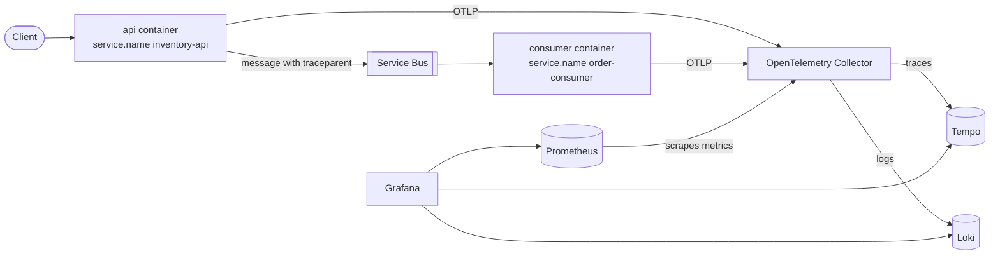

# Observability, explained

This document explains the OpenTelemetry and Grafana work, written for someone new to the topic. Everything here was checked against the real code and a running stack. Where something could not be checked, it says so.

## 1. The big picture

**Observability** means being able to understand what a running system is doing from the outside, without attaching a debugger. After this work, when a customer buys something you can answer: Which requests were slow? Which database queries ran? Did the consumer pick the order up? Why was it rejected? How many orders are stuck?

Three kinds of data ("signals") answer different questions:

| Signal | What it is | Question it answers | Example here |
|---|---|---|---|
| **Traces** | A timed record of one piece of work, split into steps called spans | "What happened to this one purchase, and where did the time go?" | `POST api/Orders`, then `order-placed publish`, then `order-placed process`, then `order.stock-check` |
| **Metrics** | Numbers measured over time | "How is the system doing overall?" | requests per second, orders confirmed vs rejected, orders Pending now |
| **Logs** | Lines of text the app writes | "What did the app say at that moment?" | `Order 12 confirmed.` |

**OpenTelemetry (OTel)** is the open standard and the library (an SDK) the app uses to produce all three signals in one common format. It does not store anything itself.

## 2. The pieces and how data flows

- **The app (api and consumer)** produces the signals and pushes them using the **OTLP** protocol (the standard way to ship OTel data).
- **The Collector** is a small service that receives the data and decides where it goes. The app only knows about the Collector, never about the storage back ends. That means you can change a back end without touching the app.
- **Tempo** stores traces, **Loki** stores logs, **Prometheus** stores metrics. Prometheus works by *pulling* (scraping) numbers, so the Collector exposes the metrics on a page that Prometheus reads every 10 seconds.
- **Grafana** is the website you look at. It reads from all three stores.

All of this runs as separate containers in `compose.yaml`; one `docker compose up` starts everything.

## 3. What was built, step by step

### The SDK in both roles
`Extensions/TelemetryServiceExtensions.cs` registers traces, metrics and logs for whichever role the process has (API, consumer or both). Settings live in `Configuration/TelemetryOptions.cs` (`Telemetry:Exporter`, `OtlpEndpoint`, `SamplingRatio`, ...), so they can be set with environment variables such as `Telemetry__SamplingRatio`.

One thing learned the hard way: which exporter to use has to be chosen while services are registered, not later. The OTLP exporter registers services of its own, and doing that inside a delayed callback crashed the containers at start-up. It was found by running the real stack, then fixed.

### Who is talking (resource attributes)
Every signal carries `service.name` (`inventory-api` or `order-consumer`), `service.version` (the commit SHA from the build, see the CI/CD document) and `deployment.environment`. This is how Grafana can tell the two containers apart.

### Automatic instrumentation
Libraries that watch the framework for you: ASP.NET Core (incoming requests), outgoing HTTP calls, EF Core (database queries) and .NET runtime metrics (memory, garbage collection, thread pool). Health check requests are excluded from traces so they do not drown out real traffic. Query text is recorded but **parameter values are not**, so personal data cannot leak through SQL.

### One purchase, one trace
A trace normally stops at the edge of a process. To continue it across Service Bus:

1. The API starts a span `order-placed publish` and writes the current trace context, the W3C `traceparent` header (a standard string holding the trace id and span id), into the message's application properties.
2. The consumer reads that value and starts its span `order-placed process` as a **child** of the publish span.

Both end up with the same trace id. This was implemented explicitly with .NET's standard context propagator rather than relying on the Azure SDK's own tracing, because it works the same against the emulator and in tests, and does not depend on an experimental SDK switch. Verified on the real stack: for 4 of 4 purchases the consumer span had the API's publish span as its parent.

### Custom spans and metrics
- Span `order.stock-check` around the stock check and decrement, with attributes `order.id`, `variant.sku` and `order.outcome`. No emails, names or tokens anywhere.
- Metrics (`Telemetry/OrderMetrics.cs`): `orders.placed`, `orders.processed` (tagged `outcome` and, for rejections, `reason`), `orders.processing.duration` (milliseconds from Pending to final status) and `orders.pending` (a gauge: how many orders are Pending right now). Tags are **low-cardinality** on purpose: each distinct tag value creates a separate time series, so an order id or SKU as a tag would create millions of them.
- The Pending gauge is reported by the **API**, not the consumer. If it came from the consumer, it would vanish exactly when the consumer is down, which is when Pending orders pile up.

### Logs
The app already used `ILogger` with message templates (`"Order {OrderId} confirmed."`). They are now also exported through OTel. Each log record carries the trace id and span id of the work it was written in, so Grafana can link a log line to its trace.

### Sampling
Keeping every trace is fine locally but expensive at scale. `Telemetry:SamplingRatio` (environment variable `OTEL_SAMPLING_RATIO` in compose) keeps a fraction of traces; the default is `1.0`, everything. A "parent-based" sampler is used so that if the API keeps a trace, the consumer keeps its part of it too.

### Grafana, provisioned from files
Under `observability/grafana/`:
- **Data sources** for Prometheus, Tempo and Loki, including two links: from a Loki log line to its trace in Tempo (using the stored `trace_id`), and from a Tempo trace to its logs.
- **One dashboard**, "Shop overview": request rate, 5xx error rate and 95th percentile latency per endpoint; confirmed vs rejected orders; 95th percentile order processing time; Pending orders now.
- **One alert**: orders stuck Pending for 2 minutes (the reasoning is in the README).

Nothing is clicked together in the UI, so a fresh clone gets the same Grafana every time. The login comes from `.env`.

A bug found by checking Grafana's stored settings: provisioning files treat `${...}` as an environment variable, so the link templates `${__value.raw}` and `${__trace.traceId}` were silently emptied. They have to be written `$${...}`.

## 4. What was verified

On a running stack (images pulled and started from empty volumes):

- All three signals arrive at the Collector (its debug output) and reach their stores.
- A log line in Loki has `trace_id` as structured metadata; the same trace id in Tempo returns 10 spans from both `inventory-api` and `order-consumer`; the query Tempo uses to jump from a trace to its logs returns 7 log lines from both services.
- Every dashboard query returns data (the 5xx panel is empty until something fails, which is correct).
- Grafana comes up from empty volumes with 3 data sources, 1 dashboard and 1 alert rule, and rejects a wrong password.
- The alert fired about 2.5 minutes after an order was left Pending (consumer stopped) and cleared about a minute after the consumer came back.
- **Collector down:** with only the Collector stopped, `POST /api/orders` still returned 202, the order was Confirmed and `/health/ready` stayed 200.
- **Load test:** 6 in stock, 20 purchases at once gave 6 Confirmed and 14 Rejected. For that burst the mean time from Pending to final status was about 1.1 seconds and the 95th percentile about 2.3 seconds.
- 114 automated tests pass, including the trace propagation and metrics tests. Deliberately removing the propagation made the trace test fail, so the test does check what it claims to.

**Not verified:** clicking the "View trace in Tempo" link in the Grafana web interface (the stored link settings and the queries behind it were checked, not the click itself); the two screenshots, which need a person (see the README).

## 5. Ten likely questions

1. **Why a Collector instead of sending straight to Tempo, Loki and Prometheus?** The app then knows one address and one protocol. Back ends can be swapped, filtered or duplicated in the Collector's config without redeploying the app.
2. **How does the consumer join the buyer's trace?** The API puts the W3C `traceparent` into the message properties; the consumer reads it and starts its span as a child.
3. **Why not use the Azure SDK's built-in tracing?** It depends on an experimental switch and is harder to test. The explicit approach is a few lines and behaves identically everywhere.
4. **What happens if the Collector is down?** The exporters drop data in the background; the API and consumer carry on. Verified: a purchase returned 202 and was processed.
5. **Why can't an order id be a metric tag?** Every distinct value creates a new time series. That blows up memory and cost. Order ids belong in traces and logs, not metrics.
6. **Why is the Pending gauge reported by the API?** So it stays visible when the consumer is down, which is exactly when you need it.
7. **How do I get from a log line to its trace?** Each log record carries its trace id; Loki stores it and a Grafana data source setting turns it into a link to Tempo.
8. **Why are health checks not traced?** They run every few seconds and would bury real requests.
9. **Could personal data leak into telemetry?** Spans and logs carry only ids and outcomes, SQL parameter values are not recorded, and metrics tags are fixed words. No emails, names or tokens are used.
10. **What does the alert mean and why 2 minutes?** The Pending count never dropped to zero for 2 minutes. Processing takes about a second, so that only happens if the consumer is stopped or stuck. It was tested by stopping the consumer.
